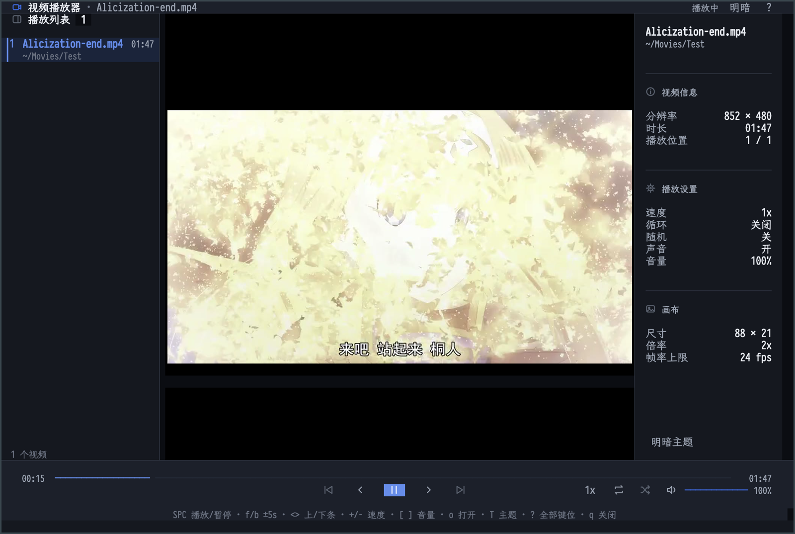
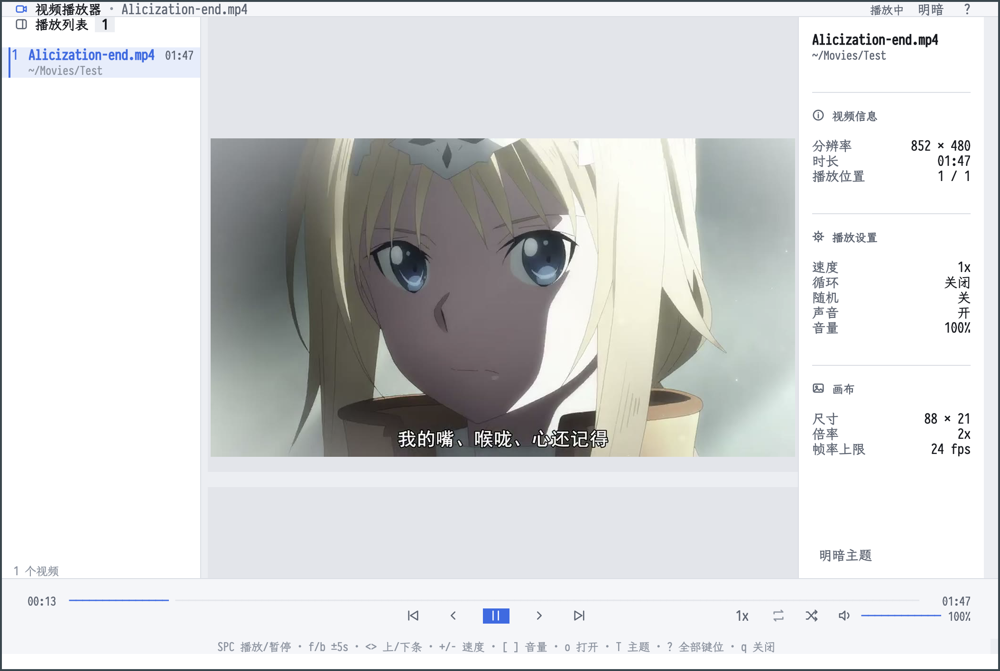

# ETAF Video Player

ETAF Video Player plays a local video or HTTP(S) stream inside an Emacs buffer
as sharp image frames with sound. It consumes ETAF's native
[`etaf-video`](https://github.com/emacs-taf/etaf) Component: ffmpeg decodes
at the display's device pixel ratio so Retina screens stay sharp, an ffplay
sidecar plays the source's audio, and every frame is published through ETAF's
retained content boundary, so one displayed frame is one incremental
publication of a fixed canvas Host, not a full re-render. This application
owns the buffer, the canvas size, the status line and the keys. For a
character-only terminal player, use the companion `etaf-ascii-video`.

The player at a wide frame:



The same layout in the light appearance:



## Capabilities

- Playback of local video files through ffmpeg; the built-in demo generates a
  test pattern with ffmpeg's `lavfi` input, so no file is needed.
- HTTP(S) video URLs play as streams: ffmpeg decodes them directly, nothing is
  downloaded first, and a dropped connection is retried for five seconds.
- Retina-sharp image frames: the producer decodes at the display's device
  pixel ratio (2x on Retina) and the image is scaled back down for display.
- Sound: an ffplay sidecar plays the source's audio track at a selectable
  volume, and pausing releases it so a long pause never catches up.
- A canvas that fits the window (and follows resizes), four grid presets, and
  explicit `etaf-video-player-set-grid` for scripts.
- A playlist sidebar: open several files (or a URL) as one queue, click an
  item to play it, and move with next/previous.  Loop (off/list/one) and
  shuffle are one key away, and a finished item advances automatically.
- Play, pause, single frame stepping, seeking, 0.5x to 8x rates, volume keys
  and a sound toggle.
- Subtitles: a SubRip (`.srt') or WebVTT (`.vtt') track beside a local file
  loads automatically and renders as one line under the canvas; `c` hides it,
  shows it again, or asks for a file, and inline markup is stripped.
- Resume: local playback positions persist in a small SQLite database and
  reopening a file continues where it stopped, unless the record is near the
  start or the end.
- Screenshots: `S` decodes the current frame with ffmpeg into a PNG beside
  the video (or the temporary directory for a stream).
- Dark and light appearances share one three-pane layout: the page, panes,
  header and transport each paint one depth step, and the stage follows the
  appearance so both palettes stay readable.  Narrow windows hide the side
  panes without changing the control identities.
- A 24fps presentation cap by default, with automatic Retina resolution;
  `etaf-video-player-display-fps` changes the cap for new players.
- Latest-frame-wins display: when decoding outruns display, older frames are
  dropped instead of replayed as a backlog.
- `etaf-video-player-state` exposes the live player as plain data for scripts
  and tests.
- Without a graphical frame the Component falls back to a density-ramp canvas,
  so the same command still shows the video in a terminal.

## Prerequisites

| Requirement | Why | Check |
| --- | --- | --- |
| Emacs 29.1 or newer | the ETAF runtime | `emacs --version` |
| `etaf`, `etaf-ui`, `ebox`, `ecss`, `etaf-db` | the framework and the playback history database; each root entry must be on `load-path` | every checkout is readable |
| ffmpeg | decoding and scaling | `ffmpeg -version` |
| ffprobe | duration, frame rate and video size | `ffprobe -version` |
| ffplay | sound | `ffplay -version` |

ffprobe is optional: without it playback uses the source defaults for
dimensions and rate and the status line shows no total duration.  ffplay is
only needed for sound; without it playback stays silent.  The decoder
programs, the density ramp and the display rate are the `etaf-video-*`
variables documented in ETAF's manual.

## Installation

```elisp
(add-to-list 'load-path "/path/to/ecss")
(add-to-list 'load-path "/path/to/ebox")
(add-to-list 'load-path "/path/to/etaf")
(add-to-list 'load-path "/path/to/etaf-ui")
(add-to-list 'load-path "/path/to/etaf-db")
(add-to-list 'load-path "/path/to/etaf-video-player")
(require 'etaf-video-player)

(global-set-key (kbd "C-c v") #'etaf-video-player-open-file)
```

## Minimal example

```elisp
(etaf-video-player-demo)                 ; generated test pattern, no file
(etaf-video-player-open-file "clip.mp4") ; a local video with sound
(etaf-video-player-open-url "https://example.com/clip.mp4") ; a network stream
(etaf-video-player-open '(:file "clip.mp4" :columns 120 :rows 34 :volume 60))
(etaf-video-player-open '(:playlist ((:file "a.mp4") (:file "b.mp4")) :loop 'all))
(etaf-video-player-set-audio nil)        ; watch it muted
(etaf-video-player-subtitle-load "clip.srt")    ; attach a subtitle track
(etaf-video-player-save-screenshot "frame.png") ; save the current frame
(etaf-video-player-history-position "clip.mp4") ; the saved playback record
```

## Keys

| Key | Action |
| --- | --- |
| `SPC` | play or pause |
| `n` | pause and present one more frame |
| `f` / `b` | seek five seconds forward or backward |
| `+` / `-` | raise or lower the playback rate |
| `[` / `]` | lower or raise the volume by 10 |
| `a` | toggle sound |
| `1` .. `4` | grid presets (64, 96, 128, 176 columns, rows follow the aspect) |
| `F` | fit the canvas to the window |
| `o` / `u` / `d` | open a file / open a URL / replay the built-in demo |
| `>` / `<` | next / previous playlist item |
| `c` | hide, show or load subtitles |
| `S` | save the current frame as a PNG |
| `L` / `s` | cycle loop mode / toggle shuffle |
| `T` | switch dark/light appearance |
| `?` / `C-c h` | searchable help inside the player |
| `q` | close the player |

The header's help button opens the same read-only, themed modal. `/` searches
the effective bindings; Escape leaves search editing before closing help.
Clicking the dimmed background closes it and restores the player focus.

## Checks

```sh
make check    # structure + byte compilation (warnings as errors) + acceptance + API boundary
make test     # the public acceptance scenarios only
```

The acceptance suite drives the repository's fake ffmpeg, ffprobe and ffplay
fixtures, so it needs no real decoder, no network, no sound and no frame; one
scenario runs the real ffmpeg when one is installed.

## Documentation

- [The manual](docs/manual.md): playback, image frames, sound, scripting,
  variables and troubleshooting.
- [Architecture](docs/architecture.md): module responsibilities, data flow,
  invariants and the ownership boundary with ETAF.
- [The root entry Commentary](etaf-video-player.el): the authoritative list of
  supported functions and variables.
